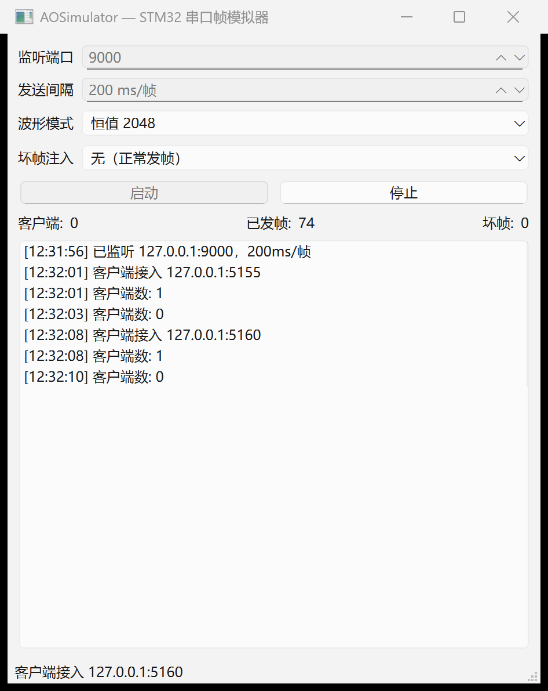

# AOSimulator — STM32 串口帧模拟器

没有硬件时，用它模拟 STM32 按 `$DATA,<AO>#` 协议持续发帧，用来联调/压测上位机（AOMonitor、SerialMonitor 等），并可**主动注入坏帧**验证解析鲁棒性。



## 协议

与 STM32 `9-2 串口发送+接收` 工程一致，逐字节对齐：

```
$DATA,<0~4095>#\r\n        例：$DATA,2048#\r\n
```

- 默认 200ms 一帧（可调 10~5000ms）
- TCP 服务端，默认监听 `127.0.0.1:9000`（只绑本机，免防火墙弹窗）
- 协议解析端（AOMonitor `FrameParser`）一行都不用改

## 波形模式

| 模式 | 行为 | 用途 |
|---|---|---|
| 恒值 2048 | 固定 2048 | 验证帧格式与计数 |
| 正弦 | 2048±2047，10 秒周期 | 模拟昼夜光照，肉眼看曲线 |
| 阶跃 | 每 5 秒在 500/3500 跳变 | 模拟开关灯，验证跳变处理 |
| 正弦+噪声 | 正弦 ±100 随机抖动 | 验证滤波/降采样 |

## 坏帧注入模式

| 模式 | 行为 | 考察解析器什么 |
|---|---|---|
| 半包 | 一帧拆两次写，间隔 50ms | 半包缓冲、等下一批数据 |
| 粘包 | 攒 3 帧一次性写出 | 一包多帧切分 |
| 垃圾前缀 | 每帧前混 5 字节垃圾 | 帧头前垃圾丢弃 |
| 空值帧 | 发 `$DATA,#\r\n` | 非法帧丢弃不崩溃、不显示脏数据 |

## 构建 / 运行

```bash
export PATH="/d/Qt/6.8.3/mingw_64/bin:/d/Qt/Tools/mingw1310_64/bin:$PATH"
cmake -S . -B build -G Ninja -DCMAKE_PREFIX_PATH=D:/Qt/6.8.3/mingw_64
cmake --build build
./build/AOSimulator.exe                 # 界面操作
./build/AOSimulator.exe --autostart     # 启动即监听（脚本化演示用）
```

### 双击运行报「无法定位程序输入点」怎么办

`cmake --build` 的 **POST_BUILD** 会自动跑 `windeployqt`，把 Qt 运行库拷到 exe 旁，正常情况下直接双击 `build\AOSimulator.exe` 即可。

如果还是报错，多半是 **PATH 上有别的软件自带的旧版 Qt** 抢先被加载。本机就有实例：
`C:\Program Files\010 Editor` 在系统 PATH 里，自带 **Qt 6.4.3** 的 `Qt6Core.dll`，
而本工程用 **6.8.3**，于是加载时报

```
无法定位程序输入点 _Z11qt_assert_xPKcS0_S0_i 于动态链接库 AOSimulator.exe 上
```

注意 **系统 PATH 永远排在用户 PATH 之前**，改用户 PATH 顺序无效。排查与修复：

```powershell
# 1) 看 exe 旁到底有没有 Qt DLL（正常情况下应该有 8 个）
Get-ChildItem build\*.dll | Select-Object Name

# 2) 看进程实际加载了哪一份 Qt6Core.dll，路径应该是 build\ 下
Get-Process AOSimulator | ForEach-Object { $_.Modules | Where-Object ModuleName -eq 'Qt6Core.dll' }

# 3) 手动补部署
windeployqt --no-translations --no-opengl-sw build\AOSimulator.exe
```


## 测试

13 项 QTest，全部走真实 TCP 环回（不 mock socket——半包/粘包只有在真 socket 上才有意义）：

```bash
export QT_QPA_PLATFORM=offscreen
ctest --test-dir build -V
# 或落盘看逐条结果（本机控制台输出偶发捕获不到）
./build/aosimulator_tests.exe -o ut_result.txt,txt
```

覆盖点：帧格式逐字节、采样值域、连接/断开计数、常量流整除性、半包重组与发送序列一致、粘包突发为 13 字节整数倍且 ≥3 帧、垃圾前缀剥离后恰好 5×帧数、空值帧不产生有效帧、停机后无新数据、UI 冒烟（点击启动→收帧→停止）。

## 覆盖率（gcovr）

```bash
export PATH="/d/Qt/Tools/mingw1310_64/bin:$PATH"
cmake -S . -B build-cov -DCMAKE_PREFIX_PATH=D:/Qt/6.8.3/mingw_64 -DENABLE_COVERAGE=ON -DCMAKE_BUILD_TYPE=Debug -G Ninja
cmake --build build-cov --target aosimulator_tests
(cd build-cov && ctest)
gcovr -r . --object-directory build-cov/CMakeFiles/aosimulator_tests.dir \
      --filter 'simulator' --exclude-throw-branches --exclude-unreachable-branches \
      --html-details docs/coverage/index.html
```

参数含义与坑见 `D:\project\QT\AOMonitor\QTest执行手顺.md` §7（`--exclude-throw-branches` 不加会让分支覆盖率虚低）。

## 设计要点（面试可讲）

1. **SimulatorCore 是纯 QObject，不碰任何 UI** —— 所以能脱离窗口做单元测试，和 AOMonitor 的 FrameParser 同一思路
2. **坏帧注入分两层**：传输层畸形（半包/粘包）与协议层非法（垃圾/空值），前者考缓冲设计，后者考校验逻辑
3. **先移除再 deleteLater**：socket 断开时若先删除后移除，广播循环会命中野指针
4. **下行限流**：`frameSent` 高频信号只刷计数不写日志，10ms 压测下日志列表不会被撑爆

## 扩展：串口回放（真反哺 STM32 测试）

装 [com0com](https://sourceforge.net/projects/com0com/) 建虚拟串口对（如 COM10↔COM11），给 `SimulatorCore` 加一个 `QSerialPort` 后端（复用同一套 `makeFrame`/坏帧逻辑），上位机开 COM11 即可联调——**不插板子就能回归整套解析链路**，还能配合 gcovr 覆盖到坏帧分支。
